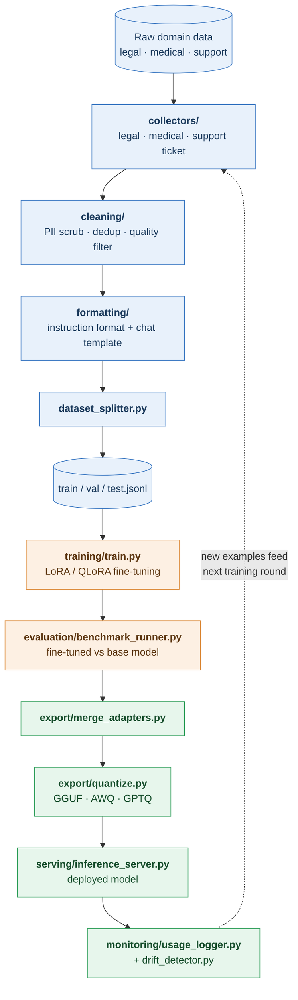

# llm-finetune-pipeline

End-to-end pipeline for fine-tuning open-source LLMs (Llama, Mistral) on domain-specific data using LoRA/QLoRA.


---

## Overview

This project fine-tunes an open-source LLM on a narrow domain (legal, medical, customer support) so it performs better on that domain's **style, terminology, and task patterns** than a general-purpose model can through prompting alone.

Unlike prompt-engineering projects, this one involves actual model training: dataset preparation, parameter-efficient fine-tuning (LoRA/QLoRA), evaluation against a base model, and deployment of the resulting weights.

**Core idea:**
Collect and clean domain data → format as instruction-response pairs → fine-tune with LoRA/QLoRA → evaluate against a held-out test set and the base model → deploy via a local or hosted inference server.

---

## Features

- **Data pipeline:** collectors, PII scrubbing, de-duplication, quality filtering, and instruction formatting
- **Parameter-efficient training:** LoRA / QLoRA via PEFT, TRL, and bitsandbytes
- **Honest evaluation:** fine-tuned vs. base model on a held-out test set, using automated metrics and LLM-as-judge
- **Flexible export:** merge adapters or keep them separate; quantize to GGUF / AWQ / GPTQ
- **Serving:** vLLM, TGI, or Ollama, plus a REST API wrapper
- **Monitoring:** usage logging and drift detection to feed future training rounds
- **Multi-domain:** legal, medical, and customer support supported out of the box

---

## How It Works

| Step | Description |
|---|---|
| 1. Data collection | Gather domain data: contracts + summaries, medical Q&A, support tickets + resolutions |
| 2. Cleaning & formatting | Convert to prompt/response pairs, remove PII, de-duplicate, balance task types |
| 3. Train/val/test split | Hold out a test set that mirrors real usage |
| 4. Base model selection | Choose Llama 3, Mistral 7B, etc., sized to your compute budget |
| 5. Fine-tuning | Train small LoRA adapter weights instead of the full model |
| 6. Training loop | Tune learning rate, epochs, batch size; track loss and eval metrics |
| 7. Evaluation | Compare against the base model with automated and LLM/human-judged quality |
| 8. Merge & export | Merge adapters (or keep separate) and convert to GGUF, AWQ, or GPTQ |
| 9. Deployment | Serve via vLLM, TGI, Ollama, or a hosted endpoint |
| 10. Monitoring | Track real-world performance and collect new examples |

### Data Flow



---

## Project Structure

```
llm-finetune-pipeline/
│
├── data_pipeline/
│   ├── collectors/          # legal, medical, support ticket data collectors
│   ├── cleaning/            # pii_scrubber, deduplicator, quality_filter
│   ├── formatting/          # instruction_formatter, chat_template, dataset_splitter
│   └── augmentation/        # synthetic_generator (optional)
│
├── training/
│   ├── config/              # lora_config.yaml, training_args.yaml, model_config.yaml
│   ├── train.py             # main training script (PEFT / transformers / trl)
│   ├── data_collator.py
│   ├── callbacks.py         # logging, checkpointing, early stopping
│   └── distributed_setup.py # multi-GPU (DeepSpeed / FSDP)
│
├── evaluation/
│   ├── benchmark_runner.py  # fine-tuned vs base model
│   ├── metrics/             # perplexity, task-specific metrics, LLM judge
│   ├── comparison_report.py
│   └── human_eval_interface.py
│
├── export/
│   ├── merge_adapters.py    # merge LoRA weights into base model
│   ├── quantize.py          # GGUF / AWQ / GPTQ
│   └── push_to_hub.py       # upload to Hugging Face Hub (optional)
│
├── serving/
│   ├── inference_server.py  # vLLM / TGI / Ollama wrapper
│   ├── api.py               # REST API
│   └── prompt_templates.py  # domain-specific system prompts
│
├── monitoring/
│   ├── usage_logger.py
│   └── drift_detector.py
│
├── notebooks/               # data exploration, training experiments, eval analysis
├── data/                    # raw/, processed/, splits/, checkpoints/
├── tests/                   # formatting, PII scrubber, evaluation metrics
├── .env.example
├── requirements.txt
├── run_training.sh
└── README.md
```

---

## Tech Stack

- **Training:** [Transformers](https://github.com/huggingface/transformers), [PEFT](https://github.com/huggingface/peft), [TRL](https://github.com/huggingface/trl), [bitsandbytes](https://github.com/bitsandbytes-foundation/bitsandbytes), [Accelerate](https://github.com/huggingface/accelerate)
- **Base models:** Llama 3, Mistral 7B (or any Hugging Face causal LM)
- **Export:** llama.cpp (GGUF), AutoAWQ, AutoGPTQ
- **Serving:** vLLM, Text Generation Inference, Ollama
- **Evaluation:** perplexity, task-specific metrics, LLM-as-judge

---

## Getting Started

### Prerequisites

- Python 3.10+
- An NVIDIA GPU (QLoRA on a 7B model runs on roughly 12-16 GB VRAM)
- A Hugging Face account and access token (for gated models such as Llama)

### Installation

```bash
git clone https://github.com/masudibnmusa/llm-finetune-pipeline.git
cd llm-finetune-pipeline

python -m venv .venv
source .venv/bin/activate        # Windows: .venv\Scripts\activate

pip install -r requirements.txt
```

### Configuration

```bash
cp .env.example .env
```

Edit `.env` and add your keys:

```
HF_TOKEN=your_huggingface_token
ANTHROPIC_API_KEY=your_key_here      # optional, for LLM-as-judge / synthetic data
```

Then adjust the YAML files in `training/config/`:

| File | Controls |
|---|---|
| `model_config.yaml` | Base model, quantization (4-bit / 8-bit) |
| `lora_config.yaml` | LoRA rank, alpha, dropout, target modules |
| `training_args.yaml` | Learning rate, epochs, batch size, scheduler |

---

## Usage

### 1. Prepare the data

```bash
# Collect raw data (pick your domain)
python -m data_pipeline.collectors.legal_data_collector

# Clean: PII scrub, dedup, quality filter
python -m data_pipeline.cleaning.pii_scrubber
python -m data_pipeline.cleaning.deduplicator
python -m data_pipeline.cleaning.quality_filter

# Format and split
python -m data_pipeline.formatting.instruction_formatter
python -m data_pipeline.formatting.dataset_splitter
```

This produces `data/splits/train.jsonl`, `val.jsonl`, and `test.jsonl`.

### 2. Fine-tune

```bash
bash run_training.sh
# or
python training/train.py --config_dir training/config
```

For multi-GPU setups:

```bash
accelerate launch --num_processes <num-gpus> training/train.py
```

### 3. Evaluate

```bash
python evaluation/benchmark_runner.py --base <base-model> --adapter data/checkpoints/final
python evaluation/comparison_report.py          # add --judge for LLM-as-judge scores
```

### 4. Export

```bash
python export/merge_adapters.py --base <base-model>
python export/quantize.py --format gguf
python export/push_to_hub.py --repo_id <username>/<repo-name>     # optional
```

### 5. Serve

```bash
python serving/inference_server.py              # starts vLLM on port 8000
uvicorn serving.api:app --port 8080            # REST API in front of it
```

---

## Data Format

Training data uses instruction-response pairs in JSONL:

```json
{"instruction": "Summarize the key obligations in this contract clause.", "input": "<clause text>", "output": "<summary>"}
```

The `chat_template.py` module converts these into the model-specific chat format (Llama, Mistral, etc.) before training.

---

## Privacy & Safety

- **PII scrubbing is mandatory** for legal, medical, and support data. Always run `pii_scrubber.py` before training.
- Never commit raw data, `.env` files, or checkpoints. They are covered by `.gitignore`.
- Medical and legal outputs from the fine-tuned model are **not professional advice**. Keep a human in the loop for any real-world use.

---

## Evaluation

The fine-tuned model is compared against the base model on a held-out test set using:

- **Perplexity** on domain text
- **Task-specific metrics** (e.g., extraction correctness, answer accuracy)
- **LLM-as-judge** scoring for response quality
- **Human evaluation** through a simple rating interface

Results are summarized side by side by `comparison_report.py`.

---

## Monitoring

After deployment, `usage_logger.py` records real-world queries and responses, and `drift_detector.py` flags when incoming data differs from the training distribution. Flagged and corrected examples feed the next fine-tuning round.

---

## Testing

```bash
pytest tests/
```

---

## Contributing

Contributions are welcome. Please open an issue to discuss major changes before submitting a pull request.

---

## License

MIT

---

## Acknowledgments

Built on the Hugging Face ecosystem (Transformers, PEFT, TRL), bitsandbytes, llama.cpp, and vLLM.